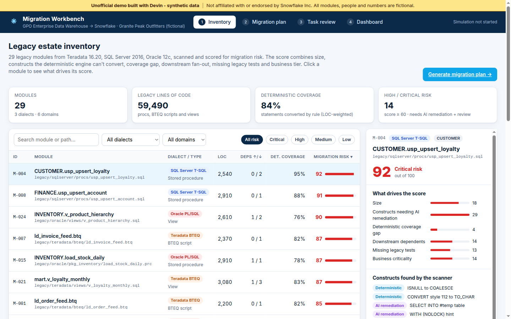

# Migration Workbench: unofficial legacy SQL → Snowflake migration demo

> **Unofficial demo built with Devin - synthetic data.** Not affiliated with or endorsed by Snowflake Inc. Every module, person, team and number is fictional and generated by [`scripts/seed.py`](scripts/seed.py).

**Live demo:** https://htmlpreview.github.io/?https://github.com/AlexBiller/snowflake-aim-migration-demo/blob/main/standalone.html (renders `standalone.html`, a single self-contained build of this repo, straight from `main`; no server or login). Rebuild it after changing the seed or app with `python3 scripts/seed.py && python3 scripts/build_standalone.py`. GitHub Pages also works if enabled in repo settings (Settings → Pages → deploy from `main`, root), at https://alexbiller.github.io/snowflake-aim-migration-demo/



A small web app that shows how Devin could run a data-warehouse migration in the style described in Snowflake's public post on its AIM application (2026-10-21): a **deterministic conversion engine for the baseline, plus AI that fills the gaps** by explaining issues, suggesting fixes and generating tests. Here Devin is the AI layer. Each migration task is a Devin session that ends in a reviewed pull request.

The estate is a fictional retailer's warehouse ("Granite Peak Outfitters"): 29 Teradata BTEQ, SQL Server T-SQL and Oracle PL/SQL modules, about 59k legacy lines.

## Walkthrough (under 5 minutes)

1. **Inventory**: browse the 29 seeded legacy modules with a 0-100 migration risk score. Filter by dialect, domain or risk band, sort columns, and click a module to see what drives its score, which constructs were flagged (deterministic vs AI remediation), its upstream and downstream dependencies, and a legacy code excerpt.
2. **Migration plan**: pick how many Devin sessions can run in parallel, the max modules per task, and whether critical-risk modules get their own PR. Then **Generate migration plan**. Modules are ordered into phases by dependency depth, and each phase is split into tasks with no dependencies between them so they can run in parallel.
3. **Task review**: open any task to compare the legacy code with the Snowflake SQL side by side. Blue lines were converted by the deterministic engine and purple lines were fixed by Devin. Click a conversion note to highlight its lines on both sides. You also get the generated tests (all passing once the task reaches review), the PR card with checks, and Devin's activity log. Use **Fast-forward to review** and **Approve & merge**.
4. **Dashboard**: press **Run simulation** (or **Advance 2h**) to watch tasks move through Converting → AI remediation → Testing → In review → Merged. No more than N sessions run at once, and a task starts only after its upstream PRs merge. The dashboard shows the burn-up chart, phase progress, running sessions and a pull request tracker.

Proof point shown in the app: Comarch, a Cognition customer, is rebuilding a 20-year-old, 10-million-line ERP system with Devin.

## Run locally

No build step, no dependencies beyond Python 3:

```bash
python3 scripts/seed.py        # regenerates data/seed.json and data/seed.js (deterministic, seed 20261021)
python3 -m http.server 8000    # open http://localhost:8000
```

State (plan and simulation) is kept in `localStorage`. Use **Reset demo** in the footer to start over.

## How it works

| File | Purpose |
| --- | --- |
| `scripts/seed.py` | Seed script. Defines 12 fictional entities across 6 domains and 6 legacy code templates (T-SQL upsert proc, BTEQ load, PL/SQL cursor proc, Teradata mart view, Oracle hierarchy view, T-SQL report view). Each template has a legacy excerpt, a converted Snowflake excerpt, line-level markers for deterministic vs AI-remediated changes, remediation notes and generated tests. It also builds the dependency graph and the risk score. |
| `data/seed.js` / `data/seed.json` | Generated output (do not edit by hand). |
| `assets/app.js` | UI: inventory, plan generation (topological phases → parallel tasks), task diff view, and the progress simulation. |
| `assets/styles.css` | Styles. |

**Risk score**: a weighted sum of size (20%), constructs needing AI remediation (25%), deterministic coverage gap (20%), downstream dependents (15%), missing legacy tests (10%) and business tier (10%), rescaled to 12-92 across the estate.

The conversion output is pre-generated by the seed script. Nothing is executed against a database and no model API is called. In a real engagement Devin would run the deterministic converter, fix the flagged constructs, generate and run tests against a sandbox, and open a PR per task.

## Data and safety

- All data is synthetic and seeded. No real customer data, code, systems or credentials.
- No login. The site is static and runs entirely client-side with no external calls.
- No Snowflake systems or APIs were accessed. Public information was used as background only.
